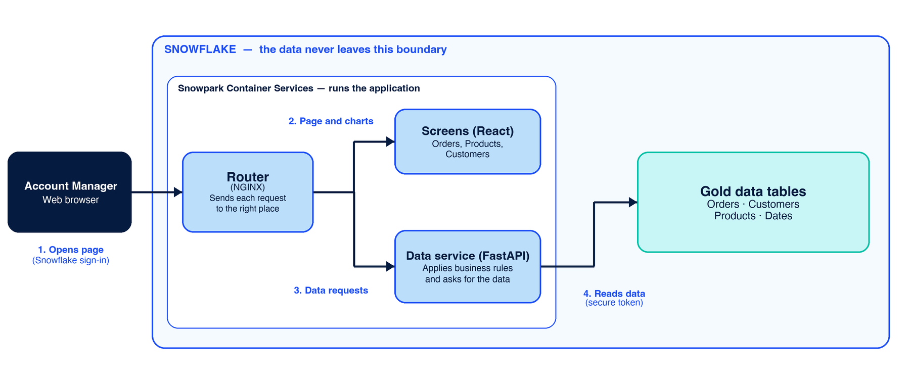

# NovaCart Account Dashboard

### Solution Design Document

*Indigo BioMed · NovaCart online retail · Team 26*

| | |
|---|---|
| **Version** | 0.2 (draft) |
| **Date** | October 14, 2026 |
| **Prepared by** | Team 26 App Consultants: Katie Nam, Eyan Jaffery, Harshi Brahmbhatt, Henry Pu |
| **Audience** | NovaCart account managers and business stakeholders |

---

## 1. The Problem and the Goal

Today, NovaCart account managers get order information from a weekly Excel report, or by asking someone to pull numbers for them. That is slow, and the numbers can differ depending on who prepared them.

**Goal:** give account managers one web page where they can look up orders, products and customers themselves, for any date range, using the same agreed numbers every time.

## 2. What We Are Building

A web dashboard with three views:

| View | What the manager sees |
|---|---|
| **Orders Overview** | Total revenue, total orders and unique customers, plus revenue by month and revenue by city |
| **Product Performance** | The top 10 products by revenue, as a chart and a table |
| **Customer List** | The top 20 customers by revenue, sortable by any column |

Every view has a start and end date filter. The dashboard also has a dark mode and a status light that shows whether the service is running.

**Out of scope:** changing any data (the dashboard is read-only), forecasting, and user-specific permissions.

## 3. How It Works

*Every component runs inside Snowflake. The manager's browser is the only thing outside it.*

**In plain words:**

1. The manager opens the dashboard in their browser and signs in with their Snowflake account.
2. The router delivers the React screens to the browser.
3. When the manager picks a date range and clicks Apply, the screens ask the data service for the numbers, through the router.
4. The data service reads the Gold data tables using a secure token, applies the agreed business rules, and sends back the results to be drawn as charts and tables.

## 4. Numbers Managers Can Trust

The data service applies the same rules on every screen:

- **Revenue** counts only orders that are **delivered or shipped**. Pending, cancelled and returned orders are left out.
- **Customer details** (name, city, state) always use the customer's **current** record.
- **All amounts** are in US dollars.
- **Data coverage:** about 30,000 orders from 400 customers across 15 products, dated 1 January to 31 December 2022 (current sample dataset, US-only). The live Snowflake dataset spans multiple countries.

## 5. Key Technology Decisions and Trade-offs

| Decision | Why we chose it | Trade-off we accepted |
|---|---|---|
| **Run inside Snowflake (Snowpark Container Services) rather than on separate hosting** | The data stays where it already lives and is already governed. Users sign in with existing Snowflake accounts, and there is no extra infrastructure to secure. | Less flexibility than a general cloud host. Setup depends on Snowflake-specific tooling, and the Snowflake team must create and manage the services. |
| **A separate data service (FastAPI) between the screens and the database** | The business rules live in one place, so every screen shows the same numbers. It also produces built-in documentation that lets us test each data request against the requirements. | One more component to build, deploy and monitor than screens that query the database directly. |
| **A small local sample database for development** | Developers can build and test without touching live Snowflake data or sharing credentials. | The code must work with two databases, so we test against both to avoid surprises at deployment. |

## 6. Security and Data Handling

- The application runs **inside Snowflake**, and users sign in with their **Snowflake account**.
- The data service only **reads** data; there is no way to change orders, customers or products from the dashboard.
- Passwords and keys are **never stored in the code**. They are supplied securely at run time.
- Error messages shown to users are **generic**. Technical details stay in internal logs.

## 7. Recommended Next Steps for NovaCart

1. **Export to Excel or CSV** to bridge the move away from the weekly spreadsheet.
2. **Explore an AI chatbot** for self-service questions and ongoing support — the client confirmed this is an acceptable direction.

---

Prepared for Indigo BioMed · NovaCart Account Dashboard · Team 26 · Draft v0.2

